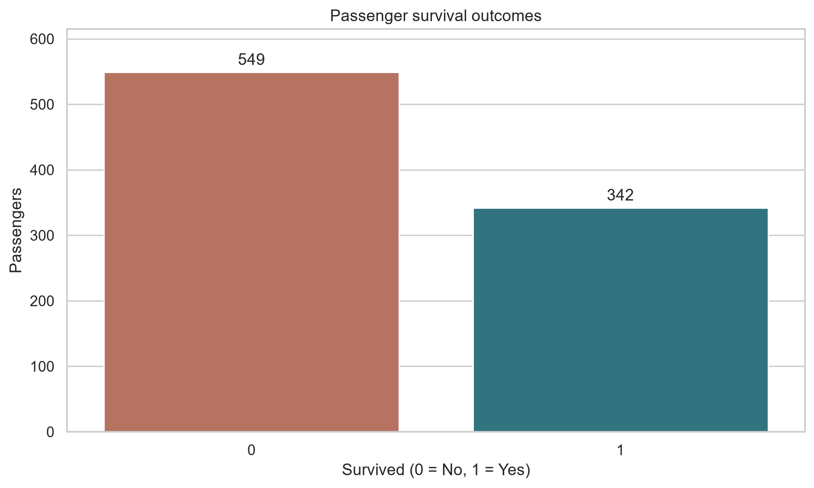
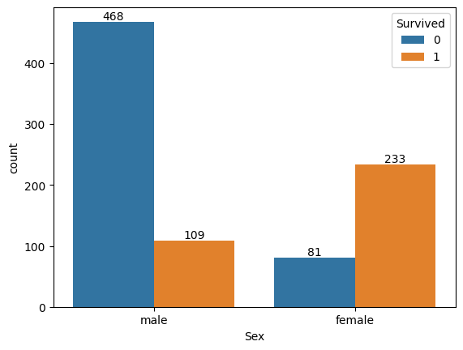
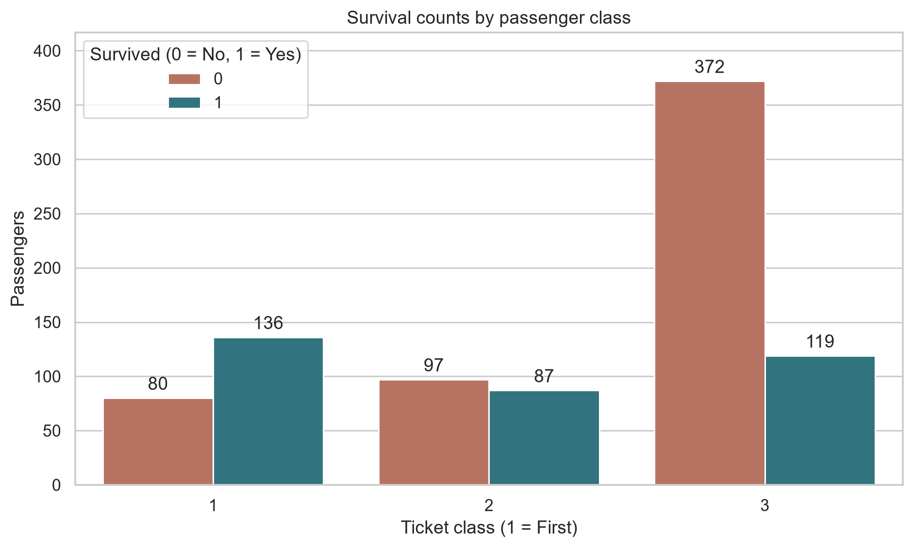
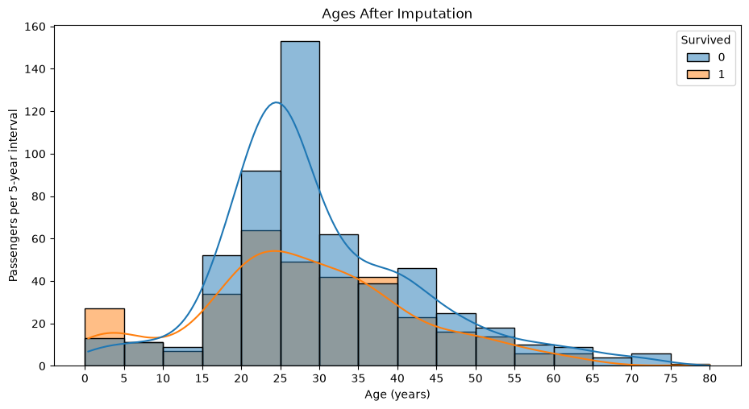
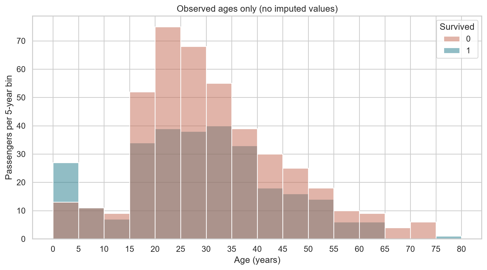
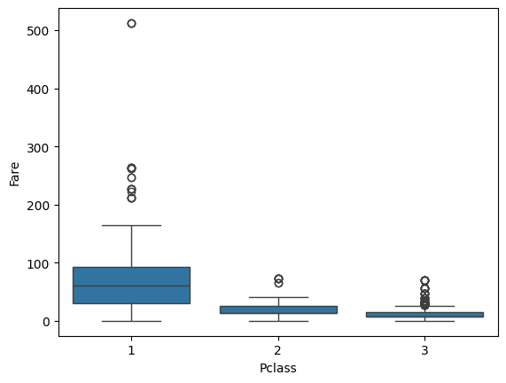
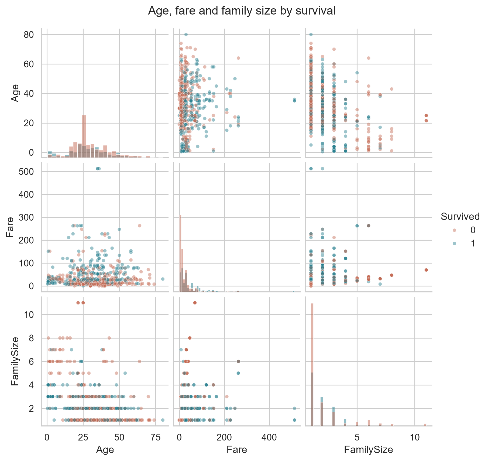
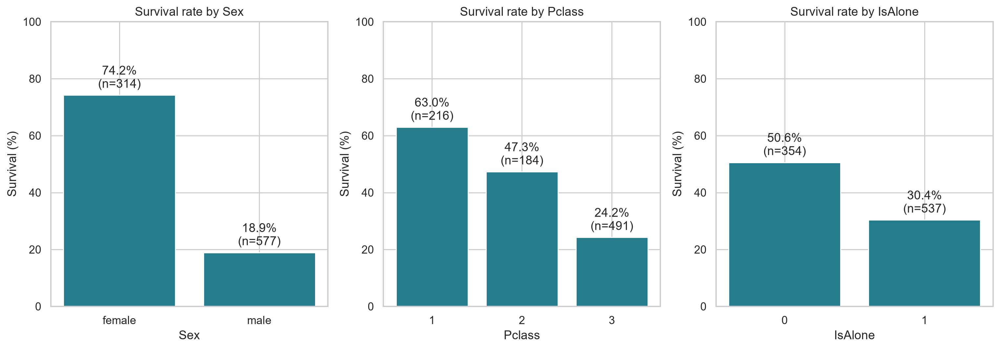
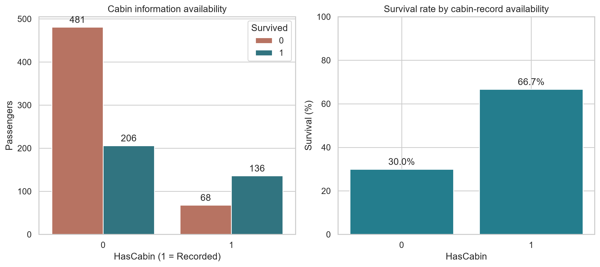

# تقرير التسليم النهائي: Titanic

إعداد: عبدالمنعم | 19 أكتوبر 2026

## تقرير التسليم النهائي

### ملخص تنفيذي

تم فحص وتنظيف وتحليل ملف بيانات يضم 891 راكبًا و12 حقلًا أصليًا. الهدف هو تقديم بيانات قابلة للاستخدام وفهم أنماط النجاة، مع توثيق قرارات التنظيف والقيود المؤثرة في تفسير النتائج.

### أبرز النتائج

نجا 342 راكبًا بنسبة 38.38%، مقابل 549 لم ينجوا.
بلغ معدل النجاة لدى الإناث 74.20% مقابل 18.89% لدى الذكور.
بلغ معدل النجاة في الدرجة الأولى 62.96%، والثانية 47.28%، والثالثة 24.24%.
بلغت نجاة من لديهم أقارب مسجلون 50.56% مقابل 30.35% لمن يسافرون منفردين وفق تعريف البيانات.

### حالة التسليم

اكتمل التحليل الوصفي وتنفيذ النوتبوك وحفظ البيانات الناتجة والصور. نجحت فحوص التنفيذ وسلامة البيانات الموضحة في قسم التحقق. يتضمن التسليم الملفات اللازمة لمراجعة النتائج وإعادة إنتاجها.

### ملاحظة تفسيرية

النتائج تخص ملف البيانات محل الدراسة. الفروق المرصودة ارتباطات وصفية قد تتداخل فيها عوامل متعددة؛ لا تستخدم وحدها كأسباب مؤكدة أو كتوقعات فردية.

## 1. نطاق العمل ومخرجاته

### الغرض من التحليل

تقييم جودة سجلات الركاب، معالجة النواقص الممكنة بمنهج موثق، ثم مقارنة النجاة حسب الجنس والدرجة والعمر والأسرة وتوافر معلومات الكابينة. يقدم التقرير شرحًا قابلًا للفهم لكل رسم ونتائج قابلة لإعادة الحساب.

### الأعمال المنفذة

1. فحص بنية البيانات وأنواعها والتكرارات والقيم الناقصة.
2. تنظيف المسافات وتوحيد التعامل مع النصوص الفارغة.
3. تعويض العمر وميناء الصعود مع تسجيل مصدر القيم المقدرة.
4. توثيق نقص Cabin وإضافة مؤشر لتوافر المعلومة.
5. فحص الأسعار المرتفعة وتوليد خصائص الأسرة والطفل.
6. إنشاء تسع رسومات، وحساب الأعداد ومعدلات النجاة.
7. تصدير البيانات والملخص الرقمي والتحقق من التنفيذ.

### حدود النطاق

يشمل التسليم تنظيف البيانات والتحليل الاستكشافي والتوثيق وإعادة التشغيل. لا يتضمن تدريب نموذج تنبؤ، أو اختبارات استدلال سببي، أو مطابقة السجل مع قاعدة تاريخية خارجية. لم تتوافر وثيقة توثق مصدر تنزيل الملف الأصلي أو شروطه.

### كيفية استخدام التسليم

ابدأ بالملخص التنفيذي والرسومات، ثم ارجع إلى منهجية التنظيف عند تقييم مدى ملاءمة البيانات. استخدم CSV للتحليل اللاحق، والنوتبوك لمراجعة الكود وإعادة إنتاج النتائج. تحتفظ مؤشرات النقص بتمييز القيم المقدرة عن المسجلة.

## 2. جودة البيانات وتعريف الحقول

### نظرة على جودة المدخلات

891 صفًا و12 عمودًا؛ لا توجد صفوف متطابقة مكررة، ومعرّف كل راكب فريد. العمر مفقود في 177 سجلًا (19.87%)، والكابينة في 687 (77.10%)، وميناء الصعود في سجلين (0.22%). بقي عدد الركاب 891 بعد المعالجة.

### الحقول الأساسية

PassengerId: معرّف الراكب. Survived: صفر لم ينجُ وواحد نجا.
Pclass: درجة التذكرة؛ 1 الأولى، 2 الثانية، 3 الثالثة.
Sex وAge: الجنس والعمر بالسنوات. Name: اسم الراكب.
SibSp وParch: الأقارب المسجلون على السفينة؛ الأشقاء/الزوج أو الزوجة، والآباء/الأبناء.
Ticket وFare: رقم التذكرة والسعر المسجل.
Cabin: رقم الكابينة إن سجل. Embarked: ميناء الصعود.

### الفحوص المطبقة

فُحص توافر الأعمدة المطلوبة، وفردية PassengerId، وقيم Survived ضمن صفر وواحد، والدرجات ضمن 1 و2 و3. كما فُحص عدم سلبية الأسعار ونطاق العمر المتوقع. هذه فحوص اتساق داخلي وليست إثباتًا مستقلًا لصحة كل معلومة تاريخية.

### أثر جودة البيانات

نقص العمر يؤثر في تحليل الأعمار، ونقص الكابينة الكبير يمنع تفسير غيابها باعتباره غيابًا فعليًا للكابينة. قد يعكس Fare حجزًا مشتركًا؛ لا يمثل دخل الراكب.

## 3. منهجية التنظيف والمعالجة

### الحفاظ على المصدر

احتُفظ بالملف الخام دون تعديل، وأجريت المعالجة على نسخة مستقلة. أزيلت المسافات من الحقول النصية وأسماء الأعمدة، وحُوّل النص الفارغ إلى قيمة مفقودة.

### تعويض العمر وميناء الصعود

عُوضت 177 قيمة عمر بوسيط المجموعة المشتركة للجنس والدرجة، مع وسيط عام كحل احتياطي. يقلل الوسيط التأثر بالقيم الشديدة، لكنه لا يعيد العمر الحقيقي لكل شخص. عُوضت قيمتا ميناء الصعود بالمنوال S. يحفظ AgeWasMissing وEmbarkedWasMissing معرفة السجلات المقدرة.

### التعامل مع الكابينة

احتُفظ بـ687 قيمة Cabin مفقودة، وأضيف HasCabin لتمييز توافر التسجيل. لم تُخترع أرقام كبائن ولم يُحذف الركاب بسبب غيابها. بقاء هذا المفقود مقصود وموثق، ولا يعني أن البيانات خالية من كل النواقص.

### الأسعار المرتفعة

حُسب IQR من الربيعين الأول والثالث. الحد العلوي Q3 + 1.5 × IQR يساوي 65.6344، وتجاوزه 116 سجلًا. احتُفظ بها مع علامة FareHighOutlier، إذ لا يكفي الارتفاع الإحصائي للحكم بأن السعر خطأ.

### الخصائص المشتقة

FamilySize = SibSp + Parch + 1. IsAlone يساوي واحدًا عندما يكون FamilySize واحدًا. IsChild يحدد العمر الأقل من 16 سنة؛ العدد 83 في هذا الملف، وكلهم ذوو أعمار مسجلة فعلًا. أضيفت هذه الحقول لتسهيل المقارنات دون تغيير متغير النجاة.

## 4.1 توزيع نتائج النجاة

### قراءة الرسم

المحور الأفقي يقسم الركاب إلى لم ينجُ ونجا، والرأسي يمثل عدد الركاب. الأرقام فوق الأعمدة تعطي العدد الفعلي. هذه نقطة البداية لفهم عدم توازن النتيجة؛ لا نفترض أن فرص النجاة كانت متساوية لمجرد وجود فئتين. نسب النجاة هنا تخص ملف التدريب فقط.

### النتيجة وما تعنيه

نجا 342 راكبًا ولم ينجُ 549؛ نسبة النجاة العامة 38.38%. المجموعة الأكبر هي من لم ينجوا.

يمثل هذا المعدل مرجعًا عامًا للمقارنات اللاحقة، وليس احتمالًا ثابتًا لكل راكب.

## 4.2 النجاة حسب الجنس

### قراءة الرسم

داخل كل فئة للجنس نقارن عمود الناجين بعمود غير الناجين. ارتفاع عدد الركاب الذكور يؤثر في الأعداد المطلقة، لذلك يجب قراءة جدول نسبة النجاة مع الرسم. الفروق المرصودة ارتباطات في العينة وقد تتداخل مع الدرجة والعمر؛ لا يمثل الجنس وحده تفسيرًا سببيًا.

### النتيجة وما تعنيه

من أصل 314 أنثى نجت 233، ومن أصل 577 ذكرًا نجا 109. المعدلان 74.20% و18.89%؛ الفرق 55.31 نقطة مئوية.

تختلف أحجام المجموعتين، لذلك تُقرأ النسب مع الأعداد. لا تعزل المقارنة تداخل الدرجة والعمر.

## 4.3 النجاة حسب درجة التذكرة

### قراءة الرسم

المحور الأفقي يوضح درجات التذاكر من الأولى إلى الثالثة. نقارن الناجين وغير الناجين داخل كل درجة، ثم نستخدم معدلات النجاة للمقارنة بين الدرجات المختلفة في الحجم. ارتفاع عدد الوفيات في الثالثة يحتاج إلى النظر إلى عدد ركابها أيضًا. الرسم لا يعزل أثر الجنس أو العمر أو موقع الراكب.

### النتيجة وما تعنيه

الأولى: 136 ناجيًا من 216؛ الثانية: 87 من 184؛ الثالثة: 119 من 491. نسب النجاة 62.96% و47.28% و24.24%.

الدرجة الثالثة أكبر عددًا وأقل معدل نجاة في العينة. المقارنة وصفية ولا تثبت أثر الدرجة مستقلًا عن بقية العوامل.

## 4.4 الأعمار بعد تعويض المفقود

### قراءة الرسم

كل عمود يمثل نطاقًا عمريًا عرضه خمس سنوات، واللون يميز النتيجة. خطوط KDE تلخص شكل التوزيع ولا تمثل احتمالات نجاة مباشرة. القمم قرب بعض الأعمار تتأثر بتعويض الأعمار المفقودة بوسيط المجموعة؛ العدد الأكبر في عمر معين لا يثبت ارتفاع أو انخفاض فرص النجاة فيه.

### النتيجة وما تعنيه

تتركز الأعمار في نطاقات الشباب والبالغين. يحتوي الرسم 177 عمرًا مقدرًا بوسيط مجموعة الجنس والدرجة.

القمم تتأثر بالتعويض. خطوط KDE تلخص شكل التوزيع، ولا تمثل معدلات النجاة أو درجة ثقة إحصائية.

## 4.5 الأعمار المسجلة فقط

### قراءة الرسم

نفس تقسيم الأعمار السابق، لكن الرسم يستبعد الركاب الذين كانت أعمارهم مفقودة. المقارنة مع الرسم السابق توضح مدى تأثر الشكل بالتعويض. هذا فحص حساسية مفيد، لكنه لا يلغي تحيز غياب العمر؛ الركاب ذوو العمر المعروف قد يختلفون عن بقية الركاب.

### النتيجة وما تعنيه

يعرض هذا الفحص 714 عمرًا مسجلًا، مع استبعاد 177 قيمة مقدرة. يوضح الفرق عن الرسم السابق حساسية التوزيع لقرار التعويض.

الاستبعاد هنا لغرض المقارنة البصرية فقط. البيانات النهائية ما زالت تحتفظ بالركاب جميعًا؛ الأعمار المعروفة قد لا تمثل المفقودة.

## 4.6 أسعار التذاكر حسب الدرجة

### قراءة الرسم

الخط داخل الصندوق يمثل الوسيط، وحدا الصندوق الربيعين الأول والثالث. الشوارب تمتد لأبعد قيمة داخل 1.5 IQR، والنقاط خارجها قيم إحصائية متطرفة وليست أخطاء مؤكدة. اللوحة اليسرى تعرض الأسعار الأصلية؛ اليمنى تغير المقياس لتسهيل رؤية القيم الصغيرة مع إبقاء الصفر. لا نخلط المسافات بين اللوحتين ولا نحذف الأسعار العالية تلقائيًا.

### النتيجة وما تعنيه

الدرجة الأولى تعرض أسعارًا أعلى وتشتتًا أوسع. توجد 116 قيمة فوق الحد العام 65.6344 احتُفظ بها.

مقياس symlog في اللوحة اليمنى يضغط الأسعار الكبيرة مع إبقاء الصفر. شوارب الرسم تحسب داخل كل درجة، بينما علامة FareHighOutlier تستخدم حدًا عامًا للملف كله.

## 4.7 العلاقات بين العمر والسعر والأسرة

### قراءة الرسم

كل لوحة خارج القطر تعرض متغيرين، والقطر يعرض توزيع متغير واحد. اللون يوضح النجاة، وتداخل النقاط يعني أن المتغيرات لا تفصل النتيجة فصلًا تامًا. تعرض المصفوفة متغيرات مختارة؛ معرّف الراكب لا يحمل معنى تحليليًا لهذه المقارنة. Fare شديد الالتواء وFamilySize متقطع، والعمر يحتوي قيمًا مقدرة؛ لذلك لا نستنتج علاقة خطية أو سببية من الشكل وحده.

### النتيجة وما تعنيه

توضح المصفوفة تداخل الناجين وغير الناجين عبر العمر والسعر وحجم الأسرة. لا يوجد فصل بصري تام بين النتيجتين.

العمر يتضمن قيمًا مقدرة، والأسعار ملتوية، وحجم الأسرة متقطع. لا تحول هذه الأنماط وحدها إلى قواعد تنبؤ أو علاقات سببية.

## 4.8 مقارنة معدلات النجاة

### قراءة الرسم

المحور الرأسي هنا نسبة الناجين داخل المجموعة، وليس العدد الكلي. n فوق كل عمود هو حجم المجموعة، وهذا يجعل المقارنة أوضح من مقارنة الأعداد وحدها. IsAlone = 1 يعني السفر دون أقارب مسجلين في SibSp وParch. اختلاف المعدلات لا يثبت أن السفر مع الأسرة سبب النجاة، ولا توجد فترات ثقة أو اختبارات دلالة في هذا الرسم.

### النتيجة وما تعنيه

المسافرون مع أقارب مسجلين: 50.56% نجاة، والمنفردون: 30.35%، بفارق 20.21 نقطة مئوية. تعرض اللوحات أيضًا معدلات الجنس والدرجة.

n يوضح حجم المجموعة. IsAlone يتعلق بالأقارب المذكورين في البيانات، ولا يثبت عدم وجود أصدقاء أو معارف. المقارنات لا تشمل فترات ثقة.

## 4.9 توافر بيانات الكابينة والنجاة

### قراءة الرسم

اللوحة الأولى تعرض أعداد الناجين وغير الناجين حسب توافر رقم الكابينة، والثانية النسبة داخل كل مجموعة. HasCabin يقيس اكتمال التسجيل وليس امتلاك كابينة. جدول التوزيع حسب الدرجة يساعد على كشف تداخل توافر المعلومة مع الدرجة؛ لذلك لا ننسب الفرق لوجود رقم الكابينة كعامل سببي مستقل.

### النتيجة وما تعنيه

رقم الكابينة متاح لـ204 ركاب، نجا منهم 136 (66.67%). الرقم مفقود لـ687، نجا منهم 206 (29.99%).

HasCabin يقيس اكتمال التسجيل. اختلاف النسب قد يرتبط بالدرجة وبطريقة التسجيل؛ لا يثبت أن توافر رقم الكابينة سبب النجاة.

## 5. الاستنتاجات والتوصيات

### الاستنتاجات الأساسية

تختلف معدلات النجاة بوضوح حسب الجنس ودرجة التذكرة، وترتفع لدى من معهم أقارب مسجلون مقارنة بالمنفردين. تتأثر قراءة الأعمار بالتعويض، وتظل معلومات الكابينة ناقصة بدرجة كبيرة. الأعداد وحدها لا تكفي للمقارنة بين مجموعات مختلفة الحجم؛ المعدلات وحجم العينة ضروريان.

### توصيات استخدام البيانات

1. استخدم CSV المنظف بدل تعديل المصدر الخام.
2. احتفظ بمؤشرات النقص عند تحليل العمر أو ميناء الصعود.
3. اذكر أن Cabin ناقص عند عرض أي استنتاج عنه.
4. لا تحذف الأسعار المرتفعة دون مراجعة سياق الحجز أو مصدر السجل.
5. اعرض حجم كل مجموعة ونسبة النجاة معًا عند المقارنة.

### تحليل إضافي مقترح

يمكن دراسة تداخل الجنس والدرجة والعمر، وإضافة فترات ثقة أو نموذج إحصائي مناسب إذا احتاج القرار إلى تقدير مضبوط. يتطلب ذلك نطاق عمل إضافيًا؛ لا توجد نتائج من هذا النوع ضمن التسليم الحالي.

### عند تطوير نموذج لاحقًا

تقسم البيانات أولًا، وتتعلم وسطاء التعويض والمنوال من التدريب وحده، ثم يقاس الأداء على بيانات لم تدخل في التعلم. لا يستخدم التحليل الحالي كدليل على دقة نموذج لم يُبنَ أو يُختبر.

## 6. التحقق وقائمة التسليم

### نتائج التحقق

نُفذت خلايا الكود الخمس عشرة بالتتابع دون أخطاء. احتُفظ بـ891 راكبًا، وظل PassengerId فريدًا ولم تتغير قيم Survived. جميع الحقول مكتملة بعد المعالجة عدا Cabin وفق القرار الموثق. تحقق تطابق HasCabin مع توافر Cabin، ووجود الصور التسع وملفي البيانات والملخص.

### المخرجات الرئيسية

هذا التقرير: العرض التنفيذي والمنهجية والرسومات والاستنتاجات.
النوتبوك: الكود الكامل ونتائجه لتمكين المراجعة وإعادة التشغيل.
CSV المنظف: 891 صفًا و19 عمودًا، تتضمن الحقول الأصلية وسبعة حقول مشتقة.
الصور: تسع صور PNG عالية الدقة، صورة لكل تحليل معروض.
الملخص الرقمي: مؤشرات محسوبة بصيغة JSON.
README: دليل الاستخدام والمتطلبات.

### ضوابط التسليم

يمثل نجاح الفحوص اكتمال التنفيذ ضمن النطاق المعلن، ولا يلغي محدودية البيانات. الملف الخام محفوظ، وتوثق المؤشرات التقديرات والمعلومات الناقصة. تفاصيل إعادة التشغيل متاحة في دليل الاستخدام، والنتائج قابلة لإعادة الحساب من المصدر نفسه.

## 7. دليل الملفات وإعادة التشغيل

### مسارات الملفات

النوتبوك داخل مجلد المشروع باسم Titanic_analysis_updated.ipynb. البيانات الخام باسم train.csv. الصور في figures، والبيانات المنظفة في output، والتقرير في output/pdf. النسخ التاريخية وملفات سجل التغييرات مراجع فنية، ولا تدخل في الاستنتاجات المعروضة.

### إعادة التشغيل

ثبّت مكتبات requirements.txt في بيئة Python مناسبة، ثم افتح النوتبوك ومجلد عمله هو مجلد المشروع نفسه. اختر Python kernel ونفذ Restart Kernel and Run All. ينبغي أن تظهر رسالة Validation passed وتتجدد البيانات والصور. عند استخدام Colab ارفع train.csv والنوتبوك إلى مجلد العمل نفسه، ثم نزّل المخرجات قبل انتهاء الجلسة.

### التحقق عند استلام البيانات

عدد صفوف CSV المنظف 891؛ عدد أعمدته 19. توجد تسع صور نهائية. قارن نسبة النجاة 38.38% وعدد الناجين 342 مع analysis_summary.json. من المتوقع بقاء 687 قيمة Cabin مفقودة؛ لا يعد ذلك فشلًا في التشغيل.

### توثيق النسخة

تاريخ التقرير: 19 أكتوبر 2026. أُعد التقرير من مخرجات النوتبوك المنفذ والملف الخام المصاحب. المرجع الرقمي للنتائج هو analysis_summary.json، وتوثق متطلبات التشغيل في requirements.txt.
