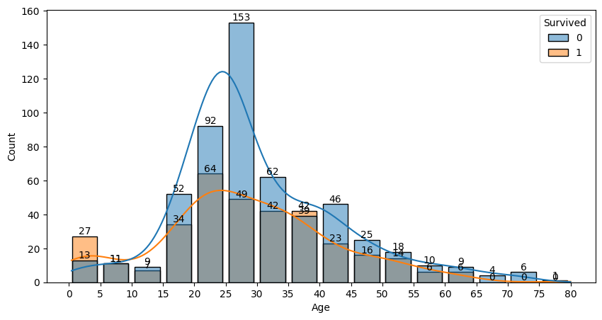

# Titanic Data Analysis Report

Prepared by Abdelmonem | 19 October 2026

## Titanic Data Analysis Report

### Executive summary

This analysis examines 891 passenger records to assess data quality and describe survival patterns. It covers missing-value handling, family and age features, and interpretation of the eight figures produced by the notebook.

### Key findings

342 passengers survived (38.38%); 549 did not survive. Female survival was 74.20%, compared with 18.89% for males. Survival rates were 62.96% in first class, 47.28% in second class and 24.24% in third class.

### Delivery status and scope

The delivery contains the notebook, raw dataset, eight figure exports and Arabic and English reports. The work covers data cleaning and descriptive analysis; it does not include a predictive model or causal-effect estimation.

### Interpretation

Rates apply to the supplied dataset. Class, sex, age and recording practices may overlap; observed differences do not establish that one variable caused survival.

## 1. Data Scope and Quality

### Dataset structure

train.csv contains 891 rows and 12 columns. Each row represents a passenger. The code uses head, info and describe to inspect structure, types and descriptive statistics.

### Field definitions

Survived: 0 = did not survive, 1 = survived. Pclass: first, second or third ticket class. Sex and Age: sex and age in years. SibSp: siblings/spouses aboard. Parch: parents/children aboard. Fare: recorded ticket fare. Cabin: cabin record, if available. Embarked: embarkation port. PassengerId, Name and Ticket are identifying fields.

### Missing values and duplicates

Age is missing in 177 records (19.87%), Cabin in 687 (77.10%) and Embarked in two (0.22%). There are no exact duplicate rows in this file. The code counts duplicates and does not delete rows.

### Source limitations

The supplied training sample does not cover every passenger on the ship. The files do not independently document the original download source or usage terms. Fare may reflect a shared booking and is not a measure of passenger income.

## 2. Cleaning and Derived Features

### Working copy and text cleanup

The code creates df_clean from df, strips column names and Embarked values, and replaces empty Embarked text with missing values. It reads train.csv from the current working directory.

### Missing-value handling

The code calculates the Embarked mode, then explicitly uses S to fill the two missing records. It fills 177 ages with the median within the combined Pclass and Sex group. No separate age-imputation indicator is retained; use the raw dataset to distinguish observed and estimated ages.

### Cabin and ticket fares

Cabin remains present with 687 missing values. The lines creating Has_Cabin and dropping Cabin are commented out and do not run. For Fare, the code calculates Q3 + 1.5 x IQR = 65.6344 and displays 116 observations above the threshold. It does not delete them or add an outlier flag.

### Family and child features

FamilySize = SibSp + Parch + 1. IsAlone equals 1 when recorded family size is 1. The Is Child column uses Age < 16 and identifies 83 passengers. The comment above it says >16, but the executed operation is younger than 16. The working dataframe contains 15 columns; the code does not export a cleaned CSV.

## 3.1 Survivor and Non-survivor Counts

### How to read the figure

The horizontal axis shows Survived as 0 or 1; the vertical axis shows passenger counts. Labels above the bars give the actual totals. A value of 0 means did not survive, and 1 means survived.

### Finding and interpretation

549 passengers did not survive and 342 survived. Overall survival is 38.38%. The outcome groups are unequal in size. This rate provides a descriptive reference for later comparisons, not a fixed probability for every individual.

## 3.2 Sex and Survival

### How to read the figure

The horizontal axis shows male and female passengers. Color indicates outcome: blue = 0, did not survive; orange = 1, survived. Compare the two bars within each group while accounting for different group sizes.

### Finding and interpretation

Males: 468 non-survivors and 109 survivors out of 577, a survival rate of 18.89%. Females: 81 non-survivors and 233 survivors out of 314, a rate of 74.20%. The difference is 55.31 percentage points. Rates are calculated here to interpret the plotted counts; the figure does not isolate age or class effects.

## 3.3 Ticket Class and Survival

### How to read the figure

The horizontal axis shows Pclass from 1 to 3; the vertical axis shows passenger counts. Blue indicates non-survivors and orange indicates survivors. Compare rates within class because class sizes differ.

### Finding and interpretation

First class: 136 survivors and 80 non-survivors, a 62.96% survival rate. Second class: 87 survivors and 97 non-survivors, a 47.28% rate. Third class: 119 survivors and 372 non-survivors, a 24.24% rate. Third class is largest, with 491 passengers. Differences are descriptive and may overlap with sex, age and passenger location.

## 3.4 Age Distribution by Survival

### How to read the figure

The horizontal axis shows age in five-year intervals from 0 to 80; the vertical axis shows passenger counts. Color distinguishes survival outcomes, and smooth KDE lines summarize distribution shapes. Overlapping bars show both groups but can obscure parts of them.

### Finding and interpretation

Many ages fall among young people and adults. The figure includes 177 ages estimated using group medians, which can create peaks at certain ages. More passengers at an age does not mean a higher survival probability. KDE curves are not survival probabilities or confidence intervals.

## 3.5 Age Distribution with Bar Counts

### How to read the figure

This is another view of the same post-imputation ages, with a different figure size, count labels and narrower bars using shrink. Five-year intervals and survival colors remain the same.

### Finding and interpretation

Labels help identify counts within intervals, but dense labels may require zooming. Both age figures use the same data; this is not an observed-age-only check or an independent analysis. The same imputation and overlapping-bar limitations apply.

## 3.6 Ticket Fares by Class

### How to read the figure

The horizontal axis shows ticket class and the vertical axis shows Fare on its original scale. The line inside each box is the median; box boundaries are the first and third quartiles. Whiskers extend to the most distant observations within 1.5 IQR of the box boundaries. Points beyond them are statistical outliers.

### Finding and interpretation

First class shows higher fares and wider variation, with a maximum of approximately 512.33. Distant points are not confirmed errors. Boxplot whiskers are calculated within each class, whereas the outlier list in the code uses an overall file threshold of 65.6344. High fares are not deleted, and the figure does not use a logarithmic scale.

## 3.7 Pairwise Relationships

### How to read the figure

Each off-diagonal panel shows two variables: the column label identifies the horizontal axis and the row label identifies the vertical axis. Diagonal panels show distributions. The nine variables are PassengerId, Pclass, Age, SibSp, Parch, Fare, FamilySize, IsAlone and Is Child. Blue represents non-survivors and orange represents survivors.

### Finding and interpretation

The outcomes overlap in many panels. PassengerId is an identifier, not an explanation of survival. Binary and discrete features naturally create clusters and lines. Age contains imputed values, and Fare is strongly skewed. The figure does not demonstrate causation or predictive accuracy. Use the accompanying PNG at a suitable zoom level to inspect the small panels.

## 3.8 Comparing Survival Percentages

### How to read the figure

The panels show survival percentages by sex, ticket class and traveling alone. The vertical axis runs from 0 to 100%, and each bar is labeled with its percentage. The code takes the mean of the binary Survived outcome within each group and multiplies it by 100.

### Finding and interpretation

Female survival is 74.20%, compared with 18.89% for males. Rates by class are 62.96%, 47.28% and 24.24% for first, second and third class. IsAlone = 0 denotes recorded relatives, with 50.56% survival; IsAlone = 1 denotes traveling alone, with 30.35%. These differences do not establish causation.

### Group sizes and comparison limits

There are 314 females and 577 males; class sizes are 216, 184 and 491. There are 354 passengers with recorded relatives and 537 classified as alone. Rates compare outcomes within groups; no confidence intervals or significance tests are shown. Traveling alone concerns recorded relatives, not the absence of friends.

## 4. Conclusions, Limits and Recommendations

### Summary

Survival rates vary by sex and class in this sample. The code also calculates survival among passengers classified as alone (30.35%) and those with recorded relatives (50.56%), and displays this comparison alongside sex and ticket class in the rate figure. IsAlone concerns relatives recorded in SibSp and Parch, not friends or all acquaintances.

### Limitations

Cabin remains extensively missing, and no cabin-availability feature is created. Imputed ages are not separately flagged and affect the age distribution. No significance tests, confidence intervals or adjusted models are included. The training sample does not cover every passenger, and the figures do not establish causes of survival.

### Recommendations

Preserve the raw source and disclose age imputation and missing Cabin information when presenting findings. Read counts and rates together; review source records before deleting high fares. If developing a model later, split the data first and fit imputation on training data only. These are future recommendations, not additional implemented processing steps.

## 5. Files and Reproduction

### Delivery files

Titanic_cleaning.ipynb: code, analysis and saved outputs.
train.csv: raw dataset.
figures/: eight images extracted from notebook outputs.
output/pdf/: Arabic and English reports.
output/: editable versions of both reports.
README.md and requirements.txt: instructions and dependencies.

### Running the analysis

Install requirements.txt, open the notebook from the project directory containing train.csv, select a Python kernel, then choose Restart Kernel and Run All. In Colab, upload train.csv to the working directory. The code displays tables and figures in the notebook; it saves the rate figure under figures/ but does not export a cleaned CSV.

### Verification and documentation

Check notebook execution and data against 891 passengers, 342 survivors, 687 remaining missing Cabin values and eight displayed figures. Report date: 19 October 2026. Descriptive figures quoted in the commentary are calculated from the data to interpret the plots and do not imply additional charts or tests.
